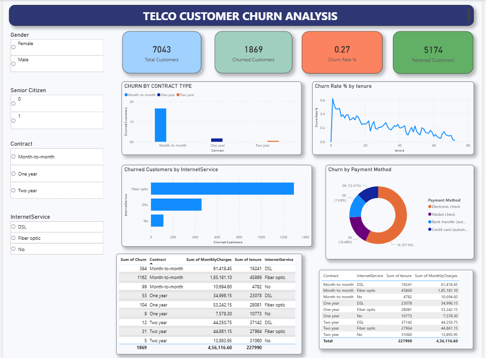

# Telecom Customer Churn Analysis — Power BI

An interactive Power BI project exploring customer churn patterns in a telecom dataset.

## Project Objective

Understand which customer segments have higher churn and explore how churn varies across contract type, tenure, internet service and payment method.

## Dashboard Preview



## Dashboard Features

- KPI cards for total customers, churned customers, churn rate and retained customers.
- Churn analysis by contract type, internet service, payment method and tenure.
- Interactive slicers for exploring customer segments.
- Customer-level detail for further investigation.

## Key Observations

- Month-to-month contract customers show the highest churn.
- Customers with shorter tenure are more likely to churn.
- Fiber optic customers show higher churn than DSL customers in this dataset.
- Electronic check users have a higher churn frequency.

These are descriptive patterns in the analysed dataset, not proof that any single factor causes churn.

## Data Preparation

The dataset was prepared for analysis by addressing inconsistent category values, handling missing values, checking data types and creating calculated measures in Power BI.

## Tools & Skills

- Microsoft Power BI
- DAX
- Data cleaning and preparation
- Data modelling
- Interactive dashboard design
- Exploratory business analysis

## Repository Structure

```text
Telco-Customer-Churn-Analysis/
├── README.md
├── Data/
├── PowerBI/
└── images/
    └── dashboard_preview.png
```

## Author

**Vaibhav Deshmukh**
